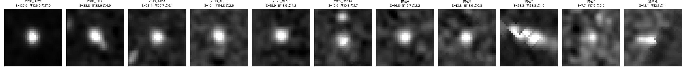

# synthetic-tracking

在公开的天文图像档案中，寻找单帧不可见的太阳系小天体。

## 问题

设同一天区在时刻 $t_1, \dots, t_N$ 拍得图像 $I_1, \dots, I_N$，每帧噪声标准差为 $\sigma$。
一个亮度为 $f$ 的天体沿轨迹 $x(t)$ 运动，在单帧中 $f < k\sigma$，无法检出。

对任一候选轨迹 $\theta$，沿轨迹叠加：

$$
S(\theta) = \frac{1}{\sqrt{N}\,\sigma} \sum_{i=1}^{N} I_i\big(x_\theta(t_i)\big)
$$

若 $\theta$ 与真实轨迹一致，信噪比约为单帧的 $\sqrt{N}$ 倍。

线性情形 $x_\theta(t) = x_0 + v\,(t - t_0)$，$\theta = (x_0, v)$。
对一组 4K×4K 的图像，候选轨迹数量级为 $10^{10}$。

## 要回答的三件事

1. **搜索**：在 $10^{10}$ 量级的 $\theta$ 上计算 $S(\theta)$，单张消费级显卡上完成。
2. **判定**：在这么多次检验下，控制误报率。设定阈值 $\tau$，使纯噪声中 $\max_\theta S(\theta) > \tau$ 的概率足够小。
3. **连接**：把不同夜晚的候选点连成同一天体，拟合出轨道。

轨迹不再是直线时（观测跨度长、天体离得近），把 $x_\theta$ 换成按日心轨道推算的位置，参数空间随之变大。

## 数据

只用公开档案：DECam（NOIRLab Astro Data Archive）、HST（MAST）、TESS。
候选天体经轨道拟合后，提交国际小行星中心（Minor Planet Center）确认。

## 实现

搜索核心用 Rust，显卡部分用 CUDA。

## 第一组数据

DEEP 巡天（NOIRLab 项目 2019A-0337），2019-07-09，芯片 S6，VR 波段，每张 120 秒。
取连续 30 张（跨 1.22 小时），对齐到第 60 张的像素网格，减去逐像素中位数，按各帧星像做匹配滤波。
权重 $a_i$ 含星像、噪声与该帧光度零点：这一晚有云，零点在 30 张内相差近 3 等。

**已知天体。** SkyBoT 列出 10 颗落在芯片上的小行星。沿星历轨迹叠加，单帧平均信噪比约 3 的天体叠加后 $S \approx 15$–$18$。
盲搜（$40 \le |v| \le 170$ 像素/小时，步长 3，共 9,544 个速度；Mac M4 Pro 的 CPU 上 37 秒）找回其中 8 颗，
位置误差 1–3 像素；漏掉的 2 颗分别贴着芯片边缘、有近四分之一时间在图外。

| 天体 | $V$ | 盲搜 $S$ |
|---|---|---|
| 1998 BK21 | 20.15 | 19.1 |
| 2014 RP11 | 20.42 | 18.4 |
| 2018 FT38 | 21.73 | 17.6 |
| 2012 DG114 | 21.73 | 12.3 |
| 2010 TJ114 | 21.79 | 14.4 |
| 2015 FJ162 | 21.90 | 18.1 |
| 2018 AB80 | 22.37 | 14.7 |
| 2020 XH18 | 22.50 | 16.5 |

（盲搜时单帧 $\psi$ 截断在 ±5，亮天体的 $S$ 因此封顶。）

**误报。** 把 $\psi$ 取反再搜：噪声对称，真实天体只有正信号，取反后搜到的都是误报。取反数据的最大 $S$ 为 6.7。
这只覆盖噪声；亮天体在错误速度上留下的"鬼影"和单帧伪影另需判别，用奇偶帧分组与叠加小图检查。

**不在 SkyBoT 中的两个移动源。** 2019-07-09 07:45:02.7 UTC：

| | RA | Dec | 速度 | 估计星等 | $S$ | 奇 / 偶帧 | 独立窗口 |
|---|---|---|---|---|---|---|---|
| A | 20:37:40.56 | −19:08:47.4 | 28.6″/时 | 22.4 | 16.8 | 11.9 / 11.9 | 8.0 |
| B | 20:37:47.28 | −19:03:55.5 | 27.2″/时 | 22.7 | 13.8 | 7.6 / 11.9 | 6.8 |

"独立窗口"：用另一个小时的 30 张图（与上面的不重叠），在按速度外推的位置附近局部搜索的最大 $S$；
同样的局部搜索放在随机位置，最大 $S$ 为 2.9–4.1。A 出现在外推位置 1 像素之内。



左起六个为已知小行星，随后为 A、B，以及两个被排除的伪影（C：两帧主导的条纹；最右：单帧亮条）。

**两处需要注意的地方。**
1. 经 astroquery 查询 SkyBoT 时，观测站参数没有起作用，返回的是地心位置。主带小行星的地平视差在这里约 2″（7 像素），且随高度角变化；未修正时，叠加几乎完全对不上。现在按地心查询，再自己减去 CTIO 的位置矢量。
2. 只按星像和噪声加权，会把有云的帧当成好帧；加入光度零点后，已知天体的 $S$ 从个位数升到上表的值。

## 用法

```
uv run python scripts/fetch.py data/night.json 30 data/frames_30     # 下载
uv run python scripts/prep.py data/frames_30 45 30 60 data/w30        # 对齐、去静止源、匹配滤波
uv run python scripts/known.py data/w30                               # 已知天体轨迹（含视差修正）
cargo build --release
target/release/st track data/w30                                      # 沿已知轨迹叠加
target/release/st search data/w30 --out data/w30/cands.json           # 盲搜
target/release/st search data/w30 --negate --out data/w30/cands_neg.json
uv run python scripts/evaluate.py data/w30 cands.json cands_neg.json  # 对照已知天体、标定误报
cargo test --release                                                  # 合成数据：单帧信噪比 2 的移动源能被找回
```

看图：在 VS Code 里打开 `notebooks/explore.ipynb`（内核选 `.venv`），依次运行。
整块芯片与已知轨迹、单帧逐帧播放、沿轨迹叠加、拖速度滑块看点浮出、原数据与取反数据的候选分布。
笔记本由 `scripts/make_notebook.py` 生成。

## 进度

- [x] 在一组 DECam 公开图像中，找回其中已知的小行星
- [x] 用取反数据标定噪声误报
- [ ] 亮天体鬼影与单帧伪影的自动判别
- [ ] 查明 A、B 是否已有记录（MPC，含孤立观测）；没有则按 MPC 格式提交
- [ ] 跨夜连接与轨道拟合
- [ ] 搜索核心移到显卡

## 参考

- Jurić et al. 2019, *Enabling Deep All-Sky Searches of Outer Solar System Objects*, [arXiv:1901.08549](https://arxiv.org/abs/1901.08549)
- *heliostack: A Novel Approach to Minor Planet Discovery*, [arXiv:2604.16731](https://arxiv.org/abs/2604.16731)
